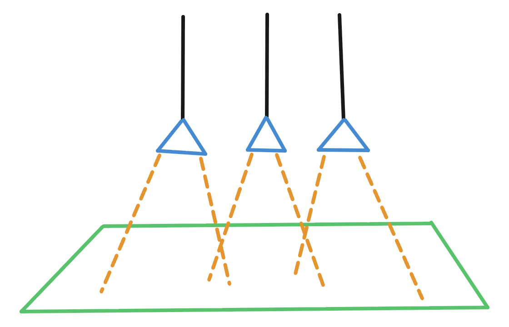

# Optik — 80er-Backroom

> **Status:** **Raum, Nebel und die drei Deckenleuchten sind umgesetzt** (`src/room.js`, `src/ceiling-lamps.js`, alle Parameter in `src/room-constants.js`). Offene Punkte stehen unten.

Das Spiel spielt in den **80ern** in einem verrauchten, schummrigen Billardcafé. Die Optik soll genau das transportieren: wenig Licht, Rauch in der Luft, ein heller Tisch im Dunkeln.

## Raum

Ein geschlossener Raum mit **Boden, 4 Wänden und Decke**, proportional zum Tisch, aber deutlich größer.

| Teil | Vorgabe |
|------|---------|
| Länge (lange Tischseite) | **30 m** (`ROOM_LENGTH`, Richtung der Tischlänge) |
| Breite | **15 m** (`ROOM_WIDTH`) |
| Höhe | **4,50 m** (`ROOM_HEIGHT`) |
| Boden | **Teppich**, dunkles Weinrot, mit feinem Rauschmuster |
| Decke | **Holz**, Bretter längs |
| Wandvertäfelung | **Glänzendes Holz** (Mahagoni, Klarlack) bis **1,80 m** (`WAINSCOT_HEIGHT`): gerahmte Füllungen (0,8 m breit), unten Fußleiste, oben eine **Abschlussleiste mit Profil** (Platte, Wulst, Rundung). Radio und Sideboard halten den Abstand `WAINSCOT_PROTRUSION`. |
| Wände (darüber) | **Creme-Gelb** („verrauchtes Weiß“), nach oben hin dunkler (Rauch sammelt sich an der Decke) |

Alle Maße und Farben sind Parameter in `src/room-constants.js`. Die freie Kamera bleibt im Raum.

## Deckenleuchten

**Drei gleiche Leuchten** über dem Tisch, nach der Skizze:

- **Form:** Kegel-Lampenschirm (Dreieck im Profil), an einem **schwarzen Kabel** von der Decke hängend.
- **Farben:** außen **blau**, innen **golden**.
- **Licht:** Kegel-Spot (cone light) mit **Softshadow**. Die Lichtkegel der drei Leuchten überlappen sich auf dem Tisch (siehe gestrichelte Linien in der Skizze).
- **Anordnung:** nebeneinander in einer Reihe entlang der Tischlänge, Abstand 0,85 m (`LAMP_SPACING`).

### Höhe als Parameter (umgesetzt)

- Die **Aufhängehöhe** (Unterkante der Leuchten über dem Boden) ist der **Parameter `LAMP_HEIGHT`** in `src/room-constants.js`, Standard **2,40 m**. Dort stehen auch Abstand, Kabellänge, Schirm- und Lichtwerte.
- Ändert man ihn (z. B. auf 2,50 m), werden **alle drei Leuchten gemeinsam** höher oder tiefer.
- Das **Kabel** passt sich automatisch an: Es ist so lang (z. B. 10 m), dass es immer **durch die Decke nach oben herausragt** und nie sichtbar endet.

## Spiegelungen in den Kugeln (umgesetzt)

- **Prinzip:** Beim Start wird der Raum einmal als Würfel-Karte aufgenommen (Tischmitte, Kugelhöhe, noch ohne Kugeln und Cue, HDR). Nur die Kugel-Materialien benutzen sie (`ball-reflection.js`), und zwar nur als Spiegelung, nicht als Licht: Die Kugeln werden dadurch nicht heller.
- **Lampenflecken:** Die Öffnung jeder Deckenleuchte ist in der Aufnahme eine helle Scheibe (`LAMP_REFLECTION_GLOW`), die sonst niemand sieht. Auf jeder Kugel erscheinen die drei Lampen deutlich als helle Flecken.
- **Perspektive:** Die Karte wird wie ein Kasten um den Tisch gelesen (Wände echt, Boden auf Filzhöhe, Decke auf Lampenhöhe), damit die Lampen für jede Kugel an der richtigen Stelle erscheinen.
- **Nicht dabei:** Kugeln spiegeln sich nicht gegenseitig; Holz und Rahmen spiegeln den Raum nicht.

## Wandleuchten (umgesetzt)

Dezente Leuchten an den Wänden (`src/wall-lamps.js`, Parameter `WALL_LAMP*` in `src/room-constants.js`):

- **Anzahl:** 2 pro kurzer Wand, 3 pro langer Wand (zusammen 10), gleichmäßig verteilt.
- **Form:** derselbe Kegel-Lampenschirm wie die Deckenleuchten (außen blau, innen golden), nur kleiner (Faktor 0,45), an einer **Messing-Halterung**: Wandplatte, Arm (25 cm aus der Wand, `WALL_LAMP_ARM_LENGTH`), kurzer Stiel, Knauf.
- **Höhe:** Schirmunterkante 2,0 m über dem Boden (`WALL_LAMP_HEIGHT`).
- **Licht:** je ein weicher, warmer Spot nach unten ohne Schatten. Er wirft einen sanften Lichtkegel auf Wand und Boden.

## Nebel / Rauch

- **Linearer Nebel von 1 m bis 12 m** (`FOG_NEAR`, `FOG_FAR`): Ab 1 m beginnt er, bei 12 m ist der Dunst am dichtesten (aber nie komplett deckend).
- **Neutral-grauer Dunst** (`FOG_COLOR`, bewusst dunkel). Nebelfarbe wird von Three.js nicht beleuchtet: ein heller Nebel hellt den ganzen Raum auf, deshalb ist er an die dunkle Stimmung angepasst. Er deckt maximal 60 % (`FOG_MAX_OPACITY`). Es gibt keinen Vignetten-Effekt (kein „Taschenlampen-Look“).
- **Beleuchtung:** Haupt-Lichtquellen sind die drei Deckenleuchten über dem Tisch. Nur ein sehr schwaches, warmes Umgebungslicht (`ROOM_AMBIENT_*`) lässt die Wände als Schemen erahnen. Der Raum bleibt dunkel, gedämpft und weich.

## Offene Punkte

- Genaue Armlänge, Höhe und Verteilung der Wandleuchten.
- Wanddekoration (Poster, Tapete, Fenster, Tür).
- Ob zusätzlich Rauchschwaden im Lichtkegel sichtbar sein sollen.
- Abstand der Leuchten zueinander.
